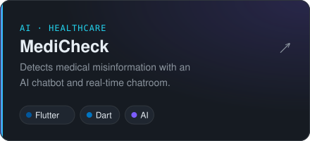
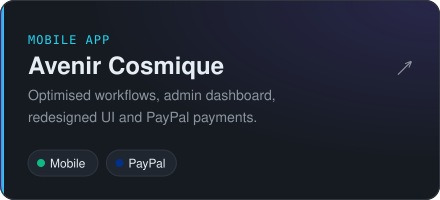
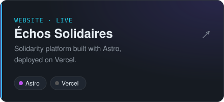
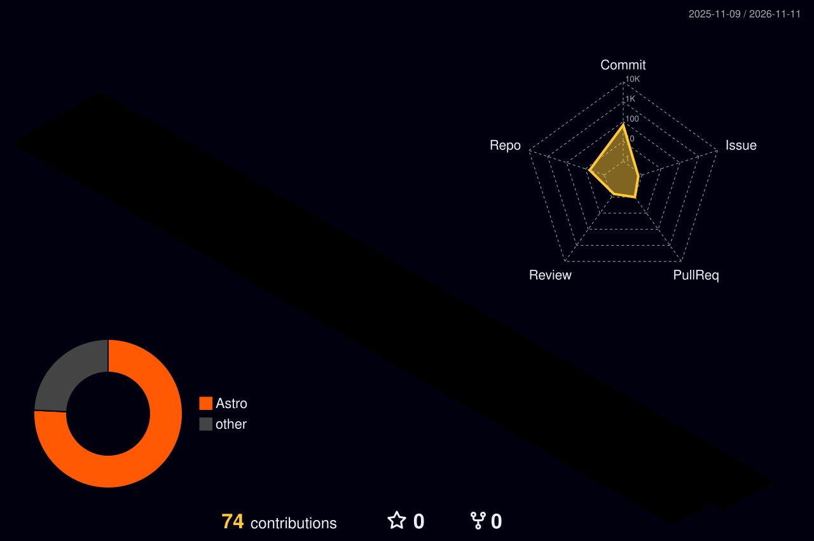
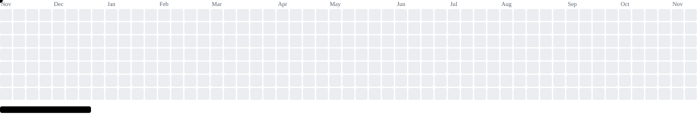

<a href="https://github.com/YassineMzoughi1">
  <picture>
    <source media="(prefers-color-scheme: dark)" srcset="./assets/header-dark.svg">
    <source media="(prefers-color-scheme: light)" srcset="./assets/header-light.svg">
    
  </picture>
</a>

<br>

I build products end to end: **native iOS apps in Swift**, **cross-platform apps in Flutter**, and **full-stack web apps in TypeScript**. I care about clean architecture, fast interfaces and shipping things people actually use.

```swift
let now = [
    "Building the ODC Learning platform — web, backend and iOS",
    "Shipping native iOS apps in Swift",
    "Bringing AI features into mobile products",
]
```

## Selected work

<p>
<a href="https://github.com/YassineMzoughi1/TripFlow"><picture><source media="(prefers-color-scheme: dark)" srcset="./assets/tripflow-dark.svg"><source media="(prefers-color-scheme: light)" srcset="./assets/tripflow-light.svg"></picture></a>
<a href="https://github.com/YassineMzoughi1/Medicheck"><picture><source media="(prefers-color-scheme: dark)" srcset="./assets/medicheck-dark.svg"><source media="(prefers-color-scheme: light)" srcset="./assets/medicheck-light.svg"></picture></a>
<br>
<a href="https://github.com/YassineMzoughi1/Avenir-Cosmique"><picture><source media="(prefers-color-scheme: dark)" srcset="./assets/avenir-dark.svg"><source media="(prefers-color-scheme: light)" srcset="./assets/avenir-light.svg"></picture></a>
<a href="https://echos-solidaires.vercel.app"><picture><source media="(prefers-color-scheme: dark)" srcset="./assets/echos-dark.svg"><source media="(prefers-color-scheme: light)" srcset="./assets/echos-light.svg"></picture></a>
</p>

## Stack

<table>
  <tr>
    <td><b>Mobile</b></td>
    <td></td>
  </tr>
  <tr>
    <td><b>Web</b></td>
    <td></td>
  </tr>
  <tr>
    <td><b>Tools</b></td>
    <td></td>
  </tr>
</table>

## Activity

<picture>
  <source media="(prefers-color-scheme: dark)" srcset="./profile-3d-contrib/profile-night-rainbow.svg">
  <source media="(prefers-color-scheme: light)" srcset="./profile-3d-contrib/profile-season.svg">
  
</picture>

<p align="center">
  <picture>
    <source media="(prefers-color-scheme: dark)" srcset="https://streak-stats.demolab.com?user=YassineMzoughi1&theme=github-dark-blue&hide_border=true&background=0D1117&ring=7C5CFF&fire=22D3EE&currStreakLabel=E6EDF3&sideLabels=8B949E&dates=8B949E">
    
  </picture>
</p>

<picture>
  <source media="(prefers-color-scheme: dark)" srcset="https://raw.githubusercontent.com/YassineMzoughi1/YassineMzoughi1/output/github-snake-dark.svg">
  <source media="(prefers-color-scheme: light)" srcset="https://raw.githubusercontent.com/YassineMzoughi1/YassineMzoughi1/output/github-snake.svg">
  
</picture>

<details>
<summary><b>More games on my contribution graph</b></summary>
<br>

<picture>
  <source media="(prefers-color-scheme: dark)" srcset="https://raw.githubusercontent.com/YassineMzoughi1/YassineMzoughi1/output/pacman-contribution-graph-dark.svg">
  <source media="(prefers-color-scheme: light)" srcset="https://raw.githubusercontent.com/YassineMzoughi1/YassineMzoughi1/output/pacman-contribution-graph.svg">
  
</picture>

<picture>
  <source media="(prefers-color-scheme: dark)" srcset="https://raw.githubusercontent.com/YassineMzoughi1/YassineMzoughi1/output/breakout-contribution-graph-dark.svg">
  <source media="(prefers-color-scheme: light)" srcset="https://raw.githubusercontent.com/YassineMzoughi1/YassineMzoughi1/output/breakout-contribution-graph.svg">
  
</picture>

</details>

<br>

<p align="center">
  <sub>Open to collaborations and interesting problems — reach out through GitHub.</sub>
  <br><br>
  
</p>
